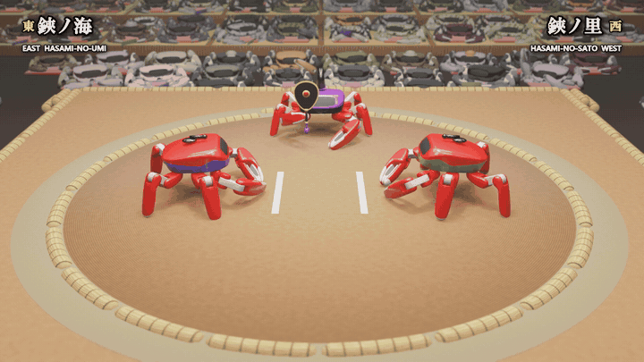

# カニの大相撲 🦀 — 相撲を覚えた 2 体の Jumper

[English](README.md)

<p align="center"></p>

**KingKong Robotics「Crab Robot Open-source Challenge 2026」への応募作品です。**
オープンソースのカニロボット [Jumper](https://github.com/KingKongRobotics/jumper) 2 体が、強化学習で相撲をゼロから覚えました。その千秋楽・結びの一番を、相撲中継のような映像にしています。

▶ **動画:** X — *リンクは投稿後に追加* ・ YouTube（チャプター付き）— *リンクは投稿後に追加*

> 映像はすべて **MuJoCo の物理シミュレーション**を **Blender** で描き直したもので、実機の映像ではありません。ロボットの体・モーター・公式の歩行方策は変えていません。力士名・会場・賜杯は架空です。音楽と効果音はすべてコードで合成しました。

## 公式ツールキットに足したもの
- **2 体の Jumper の相撲タスク**
  - 実際の土俵をカニの大きさに縮めた（半径 0.8 m）。
  - 負けの条件: 俵の外の地面に足がつく、足以外が土につく、倒れる。
  - 立ち合いは、両者が仕切り線の後ろで両手をついてから。合図の前に飛び出すと「待った」。
- **2 段の方策**
  - **戦術**（PPO で学習）が、毎秒 200 回、動き方・構え・ハサミの使い方を決める。
  - **脚**（公式の歩行方策を、押す相撲向けに学習し直して固定）が、それを 20 関節の目標値に変える。
- **行司ロボット**
  - 3 体目の Jumper で、本物の体を持つのでぶつかることもある。5 本脚で歩き、ハサミで軍配を持つ。
  - 学習した方策で、取組が見える位置に立つ。
  - 仕切りの掛け声、勝負の判定、決まり手の判定を行う。
- **リーグ戦**
  - 約 70 回の学習を、それぞれ過去の世代を相手にした。
  - 総当たり戦は 37 万番以上（1 組 1,024 土俵 × 20 秒）。Bradley–Terry で 1 本の強さの尺度にまとめた。
- **中継映像**
  - MuJoCo の再生から、各部品の位置を Blender 5.2 に書き出して描いた。観客は 1,000 体以上の Jumper。
  - 中継画面の文字は日本語と英語。
  - 場内の音と BGM（櫓太鼓・三味線・篠笛など）は NumPy で合成した。

## 主な結果
- **脚が壁だった。** 同じ戦術でも、押しの脚が機敏な脚に 1,561 対 375（81 %）で勝つ。
- **上位は頭打ち。** 上位は強さ 1,670〜1,700 に集まっていて、隣どうしの勝率は 51〜54 %。
- **ハサミ技には長い学習が要る。** 350 回の学習ではハサミ技の勝ちが 2〜5 % だった。約 1,500 回学習した waza70 は 13〜15 % で、waza50 に 1,422 対 1,156 で勝ち越した。
- **決勝の選び方。** 121 番から「見どころ点」で選んだ。中央で組み合った時間、俵際で残った時間、逆転、押し出し以外の決まり手で採点する。決勝では、鋏ノ海の左中脚が中心から 0.871 m（俵は 0.8 m）の土に着き、鋏ノ里の勝ち（足取り）。

詳しくは [`docs/METHOD.md`](docs/METHOD.md)（手法）、[`docs/RESULTS.md`](docs/RESULTS.md)（結果）、[`docs/REPRODUCE.md`](docs/REPRODUCE.md)（再現）、[`docs/MAKING_OF.md`](docs/MAKING_OF.md)（失敗と直したこと）にあります（英語）。

## 再現
```bash
git clone https://github.com/KingKongRobotics/jumper.git && cd jumper
git checkout 61d065219fca767f3142c8f10aff59eae5a5a004
git apply ../jumper-crab-sumo/jumper_patch/jumper-sumo.patch
```
学習済みモデルは [`models/`](models/README.md) にあります。

## ライセンス
Apache-2.0。KingKongRobotics/jumper（Apache-2.0）を土台にしています（[`NOTICE`](NOTICE)、[`NOTICE.upstream`](NOTICE.upstream)）。

`#Jumper #CrabRobot #OpenSourceRobot`
