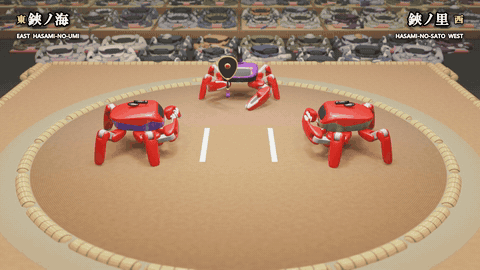
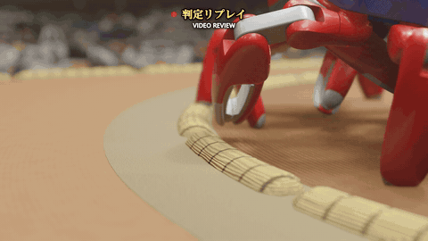
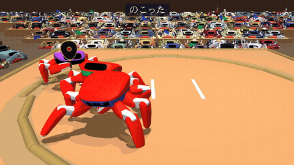
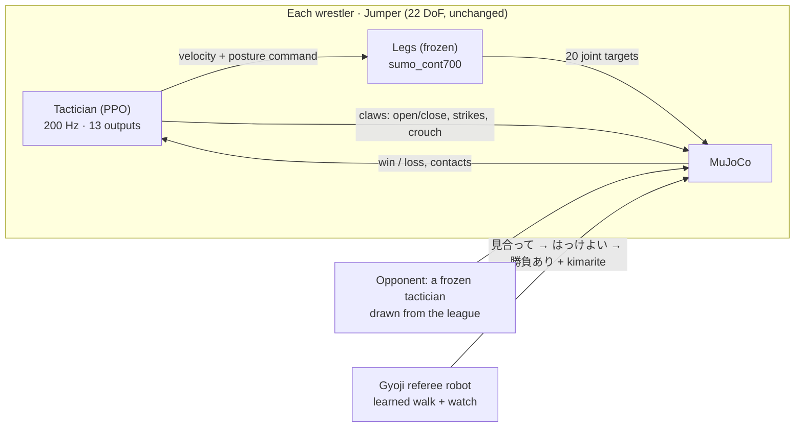

# Crab Sumo 🦀 — two Jumper robots that learned sumo

[](https://github.com/shellcat7/jumper-crab-sumo/actions/workflows/check.yml)


<p align="center"></p>

**Entry for the KingKong Robotics Crab Robot Open-source Challenge 2026.**
Two [Jumper](https://github.com/KingKongRobotics/jumper) crab robots learned sumo from scratch with
reinforcement learning and fought a final, filmed like a sumo broadcast. The film includes the
ceremony, the tachiai, an 18-second chest-to-chest bout, a comeback at the straw, a video review
of the deciding foot, and the champion.

▶ **Video:** [YouTube (with chapters)](https://youtu.be/CPhzGBQJm7c) ·
日本語: [README.ja.md](README.ja.md)

> Everything shown is a **MuJoCo physics simulation**, re-rendered in **Blender**. It is not real-robot
> footage. The robot's body, motors and the official walking policy are unchanged. The wrestler
> names, venue and cup are fictional. All music and sound effects are synthesized in code.

---

## What we built on top of the official toolkit

| | |
|---|---|
| 🏟️ **A sumo task for two Jumpers** | A ring at crab scale, real rules mapped to a hexapod (a foot outside the straw, any other part on the clay, or a fall loses), the shikiri and tachiai (both wrestlers must put their claws down behind their lines), and false starts called as *matta*. See [`docs/METHOD.md`](docs/METHOD.md). |
| 🧠 **A two-level policy** | A **tactician**, learned with PPO, decides at 200 Hz where to go, how to stand and what to do with the claws. A frozen **legs** policy, the official walking policy retrained to push, turns that into the 20 joint targets. |
| 🧑‍⚖️ **A referee robot (gyoji)** | A third Jumper, a real body that can be bumped into. It walks on five legs with its own learned walking policy, holds the gunbai in a claw, and has a learned "watching" policy. It runs the shikiri calls, keeps out of the way while keeping the bout in sight, and calls the decision and the **kimarite** (winning technique), classified from the contacts at the moment of decision. |
| 🏆 **League training** | About 70 training runs, each against a league of earlier generations. Every model was ranked in round-robin leagues (**370,000+ simulated bouts**, 1,024 parallel rings × 20 s per pairing) and placed on one Elo scale with a Bradley–Terry fit. |
| 🎬 **A broadcast** | A MuJoCo replay dumps every geom pose. Blender 5.2 renders the arena, a crowd of 1,000+ seated Jumpers and the cameras. Python adds the broadcast graphics (Japanese and English). The hall sound and a taiko/shamisen score are synthesized in NumPy. |

<p align="center">



</p>
<p align="center"><sub>The ceremony (chiri-chōzu) · the video review of the deciding foot · waza70, trained to use its claws, wins by tsukidashi</sub></p>

---

## How it works



- **Observation (tactician):** its own body-frame motion and tilt; the opponent's position,
  heading, velocity and tilt in the robot's frame; the ring (how near each robot is to the straw);
  and the bout's phase. Options add a trend of how the opponent has been moving, the claws' state
  (16 inputs) and a short memory.
- **Action:** 6 commands for velocity and posture, which the frozen legs follow, plus 7 for the
  claws.
- **Reward:** ±30 for the bout, shaping for pushing outwards and staying engaged, penalties near
  the straw and for jerky commands. Optional bonuses pay more for rare techniques, comebacks and
  claw techniques. Full table in [`docs/METHOD.md`](docs/METHOD.md).

---

## Results

<p align="center"></p>

| Model | Elo* | Note |
|---|---:|---|
| `sogo_waza6` | 1211 | an early run |
| scripted circler (`tactics_mawari`) | 1358 | baseline |
| `sogo_waza24` | 1500 | new legs (Elo anchor) |
| old league champion (`league_sumo`) | 1653 | the strongest before the pusher legs |
| **鋏ノ海 Hasami-no-Umi** (`waza47`) | 1667 | finalist, trained for variety |
| `waza50` | 1673 | top of the later round robin (5–1) |
| `waza70` | 1684 | claw bonus, about 1,500 iterations |
| **鋏ノ里 Hasami-no-Sato** (`waza39`) | 1690 | finalist, the pusher |

\*Bradley–Terry on all league results, Elo scale (+100 ≈ 64 % wins), anchored at waza24 = 1500.
Details and the full table are in [`docs/RESULTS.md`](docs/RESULTS.md).

- **The legs were the bottleneck.** On the agile legs, the old league champion beat the whole
  later line of tacticians. The same tactician (waza32) on legs retrained to push
  (`sumo_cont700`) beat itself on the agile legs 1,561–375 (81 %).
- **The top has plateaued** at about 1,670–1,700: neighbours there win 51–54 % against each other.
- **Claws take long training.** A claw bonus did little in 350 iterations (2–5 % of wins by claw
  techniques). After about 1,500 iterations, `waza70` wins 13–15 % by its claws, mostly
  tsukidashi, and beats `waza50` 1,422–1,156.
- **The final** (seed 118 of 鋏ノ海 v 鋏ノ里) was picked from 121 simulated bouts by a "drama" score:
  time locked in the middle, holding at the straw, comebacks, and a technique other than the
  push-out. 鋏ノ海's left middle foot comes down 0.871 m from the centre, past the straw at
  0.8 m, and 鋏ノ里 wins by ashitori (leg pick).

---

## Reproduce

```bash
git clone https://github.com/KingKongRobotics/jumper.git && cd jumper
git checkout 61d065219fca767f3142c8f10aff59eae5a5a004
git apply ../jumper-crab-sumo/jumper_patch/jumper-sumo.patch     # checked by CI on every push
```

Then use the checkpoints in [`models/`](models/README.md) to replay the final, render it, or train.
The commands are in [`docs/REPRODUCE.md`](docs/REPRODUCE.md).

## Repository

```
jumper_patch/   our changes to KingKongRobotics/jumper @ 61d0652, as one patch (git apply)
jumper/         the same 34 new/changed files, to read here
models/         the finalists, the later models, the legs and the referee (+ model card, SHA256SUMS)
tools/          replay & dump (viewer), Blender scene & graphics & hall sound (blender),
                edit & score & thumbnails (media), drama score / strength chart / stats (eval)
spec/           the film's cut list and bout cards
docs/           METHOD · RESULTS · REPRODUCE · MAKING_OF (what failed and how we fixed it)
```

## Limitations

- Simulation only. The pusher legs and the tacticians have not been run on a real Jumper.
- The tactician reads the opponent's state directly (position, heading, velocity), not from cameras.
- The kimarite are named by a heuristic from contacts at the moment of decision. It is not a learned classifier.
- The crowd and the arena are decoration: they are not part of the physics.

## License & acknowledgements

Apache-2.0. This project is built on [KingKongRobotics/jumper](https://github.com/KingKongRobotics/jumper)
(Apache-2.0): see [`NOTICE`](NOTICE) and [`NOTICE.upstream`](NOTICE.upstream). Thanks to KingKong
Robotics for open-sourcing Jumper and its training toolkit. If you use this work, see
[`CITATION.cff`](CITATION.cff).

`#Jumper #CrabRobot #OpenSourceRobot`
