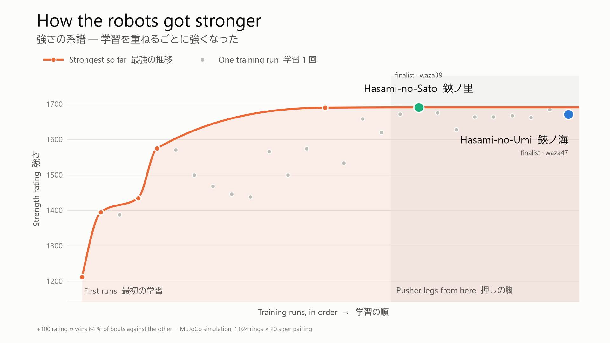

# Results

All numbers come from simulated bouts: MuJoCo Warp, 1,024 parallel rings × 20 s per pairing, the
first bout of each ring, judged by the referee. 370,000+ bouts in all.

## Strength across training runs

How the scale is built:
- A Bradley–Terry model is fitted to every round-robin result at once and put on the Elo scale
  (400 points = 10:1 odds), anchored at waza24 = 1500.
- +100 Elo ≈ 64 % wins against the other.
- A name ending in `c` is a tactician on the pusher legs (`sumo_cont700`). The others are on the
  earlier, agile legs.

Selected models:

| Model | Legs | Elo | Bouts | Note |
|---|---|---:|---:|---|
| sogo_waza71c | pusher | 1698 | 5,040 | claw bonus 100, comeback 40 |
| **sogo_waza39c — 鋏ノ里 Hasami-no-Sato** | pusher | 1690 | 35,144 | finalist (west, 大関 ozeki) |
| sogo_waza70c | pusher | 1684 | 5,421 | claw bonus 150, comeback 40 |
| sogo_waza46c | pusher | 1683 | 9,890 | league-heavy |
| sogo_waza48c | pusher | 1677 | 16,953 | |
| sogo_waza50c | pusher | 1673 | 57,909 | won the later top-7 round robin (5–1) |
| sogo_waza32c | pusher | 1673 | 9,929 | the same tactician as waza32 |
| **sogo_waza47c — 鋏ノ海 Hasami-no-Umi** | pusher | 1667 | 50,513 | finalist (east, 横綱 yokozuna), variety bonus |
| league_sumo | pusher | 1653 | 152,762 | the old league champion, the yardstick |
| sogo_waza36 | agile | 1619 | 7,479 | comeback bonus |
| sogo_waza21 | agile | 1575 | 735 | self-play |
| sogo_waza32 | agile | 1574 | 20,575 | |
| sogo_waza24 | agile | 1500 | 11,407 | new legs; the anchor |
| sogo_waza25 | agile | 1469 | 12,633 | |
| sogo_waza20 | agile | 1434 | 839 | |
| sogo_waza18 | agile | 1388 | 1,116 | |
| tactics_mawari | — | 1358 | 5,927 | scripted circler (baseline) |
| sogo | — | 1249 | 4,484 | an early all-rounder (baseline) |
| sogo_waza6 | agile | 1211 | 2,438 | an early run |

## Findings

**1. The legs were the bottleneck.**
- Through the first ~35 runs, the league's old champion still beat the newest tacticians.
- A swap test put the same brains on different legs. waza32 on the pusher legs beat waza32 on
  the agile legs **1,561–375 (81 %)**.
- From then on, every tactician was trained on the pusher legs.

**2. The top has plateaued.**
- The best twenty models sit within about 1,670–1,700 Elo, where neighbours win 51–54 % against
  each other.
- More iterations of the same recipe moved the top little. The gains came from the legs, from the
  league, and from rewards that change what the policy does (variety, comeback, claws).

**3. Claws need long training.**

| Run (base, claw bonus, comeback) | Iterations | v waza50 | Claw-technique wins v waza50 | v league_sumo |
|---|---:|---|---:|---:|
| u6 runs (claw bonus 0–100) | ~350 | — | 2–5 % (waza50: 3–6 %) | — |
| **waza70** (waza63, 150, 40) | ~1,500 | **1,422–1,156 (.552)** | **13.4 %** (tsukidashi 177) | **14.9 %** |
| waza65 (waza63, 60, 30) | ~1,500 | 1,168–1,144 | 4.0 % | 13.3 % |
| waza68 (waza48, 150, 20) | ~1,500 | 1,203–1,145 | 5.9 % | 12.1 % |
| waza71 (waza50, 100, 40) | ~1,500 | 1,256–967 (.565) | 2.5 % | 4.3 % |
| waza66 (waza63, 100, 30) | ~1,500 | 1,414–1,175 | 5.3 % | 6.8 % |

- The claws grew into **thrusts** (tsukidashi). The leg pick (ashitori) did not.
- waza70 is both stronger than waza50 and wins by its claws three to four times as often.

**4. How the finalists win.** Share of each finalist's wins in the round robins:

| | push-out (oshidashi) | pull-down (hikiotoshi) | force-out (yorikiri) |
|---|---:|---:|---:|
| 鋏ノ海 Hasami-no-Umi (waza47) | 51 % | 29 % | 16 % |
| 鋏ノ里 Hasami-no-Sato (waza39) | 70 % | 12 % | 15 % |

- Head to head: 鋏ノ海 1,305 – 1,106 鋏ノ里.
- 鋏ノ海 won 52.8 % of 5,338 test bouts, 鋏ノ里 55.1 % of 27,296.

## The filmed final

- **How it was picked.** 121 first bouts of the candidate pairs were played without pictures and
  ranked by the drama score (`tools/eval/drama.py`). The winner was seed 118 of
  鋏ノ海 (east) v 鋏ノ里 (west).
- **The bout** (score 5.49):
  - tachiai at 6.9 s;
  - 18.3 s locked chest to chest, 16.4 s of it in the middle;
  - 鋏ノ里 driven to the straw, then comes back;
  - decided at 25.76 s.
- **The decision.** 鋏ノ海's left middle foot comes down at 0.871 m from the centre, past the straw
  at 0.8 m: *stepped out*. The kimarite is **ashitori**, because 鋏ノ里 was holding a leg at the
  decision.
- **Checks.** The searched and the filmed runs of the same seed gave the same call, and so did the
  claw-win clip (seed 302 of waza70 v waza50: tsukidashi at 6.98 s in both).
